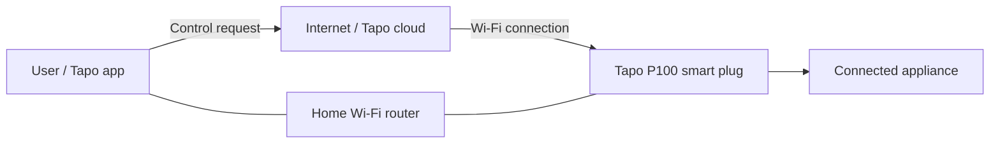

# IoT Threat Model: TP-Link Tapo P100 Smart Plug

This README identifies the main assets, realistic threats, and
proportionate security controls for a TP-Link Tapo P100 smart Wi-Fi
plug. It is based on the provided device-security report and the
manufacturer's product information.

## Device overview

The Tapo P100 connects to a 2.4 GHz Wi-Fi network and can be controlled
through the Tapo mobile app. Bluetooth is used during initial setup
(onboarding). Remote control and other app features depend on the
device, network, account, and cloud services working correctly.

**Manufacturer information:** [TP-Link Tapo P100 product
page](https://www.tapo.com/en/product/smart-plug/tapo-p100/v2/)

## How the system works

The diagram is a simplified conceptual view. Actual communication paths
can vary by feature and device firmware version.

## Threat model

  -----------------------------------------------------------------------
  Element                             Description
  ----------------------------------- -----------------------------------
  **Assets**                          Control over the connected
                                      appliance, Tapo account
                                      credentials, Wi-Fi credentials, and
                                      smart-home access.

  **Threats**                         An attacker could compromise the
                                      Tapo account, exploit an unpatched
                                      software/firmware vulnerability, or
                                      attempt to interfere with the
                                      device during its setup process.
                                      Unauthorized control could switch
                                      the appliance on or off.

  **Potential impact**                Loss of control or availability,
                                      unwanted appliance operation, or
                                      exposure of account/network access.
                                      The exact impact depends on what
                                      appliance is connected.

  **Response**                        Use a strong, unique Tapo account
                                      password; secure the home Wi-Fi
                                      with WPA2/WPA3 as supported by the
                                      router and device; keep the Tapo
                                      app and plug firmware updated; and
                                      share device access only with
                                      trusted people.
  -----------------------------------------------------------------------

## Main risks and mitigations

### 1. Tapo account compromise

**Risk:** Someone who gains access to the account may be able to control
the plug or access associated smart-home information.

**Mitigations:** - Use a long, unique password for the Tapo account. -
Protect the email account used for recovery with a unique password and
available additional security controls. - Do not share account
credentials unnecessarily.

### 2. Outdated software or firmware

**Risk:** Older versions may contain vulnerabilities that have since
been addressed.

**Mitigations:** - Check for and install available firmware updates. -
Keep the Tapo app updated. - Replace or stop relying on a device if it
no longer receives security updates and the remaining risk is
unacceptable.

### 3. Wi-Fi or network weakness

**Risk:** Weak router security can expose connected smart-home devices
to additional risk.

**Mitigations:** - Use WPA2-AES or WPA3 where supported. - Set a strong
Wi-Fi password and update the router firmware. - If practical, place IoT
devices on a separate guest or IoT network.

### 4. Unauthorized setup or physical access

**Risk:** A nearby person may have an opportunity to interfere with
initial setup, particularly when the plug is unconfigured or has been
reset.

**Mitigations:** - Set up the plug in a controlled environment. - Do not
leave a reset or unconfigured device unattended during onboarding. -
Keep physical access limited to trusted people.

## Picture: product security features

This is a manufacturer-provided illustration of the product and its
physical safety features. It should not be interpreted as proof that
every cybersecurity risk is eliminated.

## Scope and assumptions

-   This is a high-level threat model, not a penetration test or a
    guarantee that the device is secure.
-   The provided report describes earlier vulnerabilities and indicates
    that some were addressed in later versions. The installed firmware
    version should be checked before drawing conclusions about a
    specific device.
-   The exact security-update lifetime is not assumed here.
-   The model focuses on realistic risks and low-effort mitigations
    rather than invasive testing.

## Sources

-   User-provided report about the TP-Link Tapo P100 smart Wi-Fi plug.
-   [Official TP-Link Tapo P100 product
    page](https://www.tapo.com/en/product/smart-plug/tapo-p100/v2/)

## AI-use statement

ChatGPT was used to help organize and draft this threat model. The
device description and risks should be checked against the provided
report and the actual device configuration before submission.
